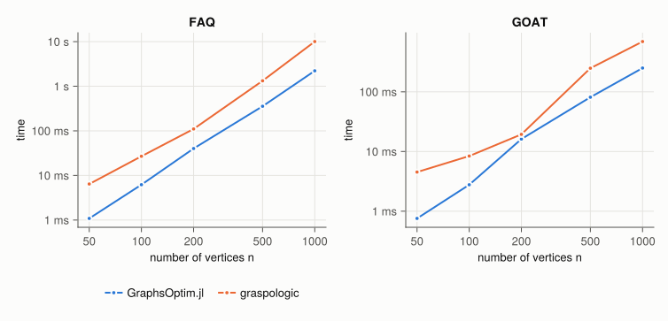
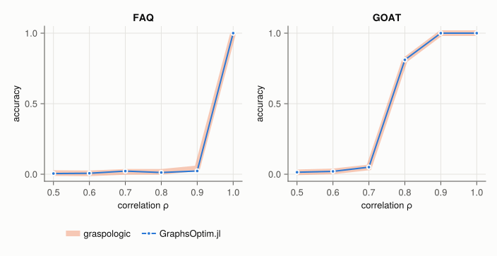
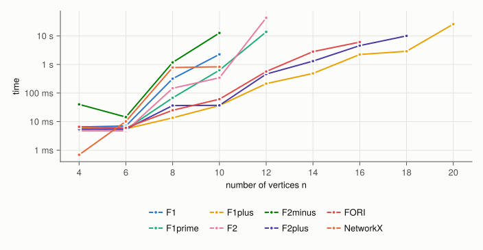
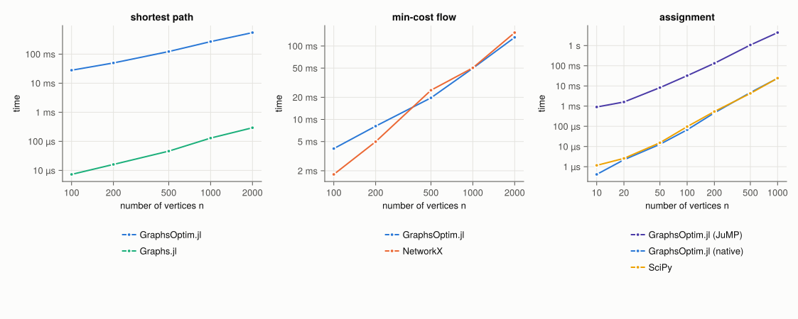
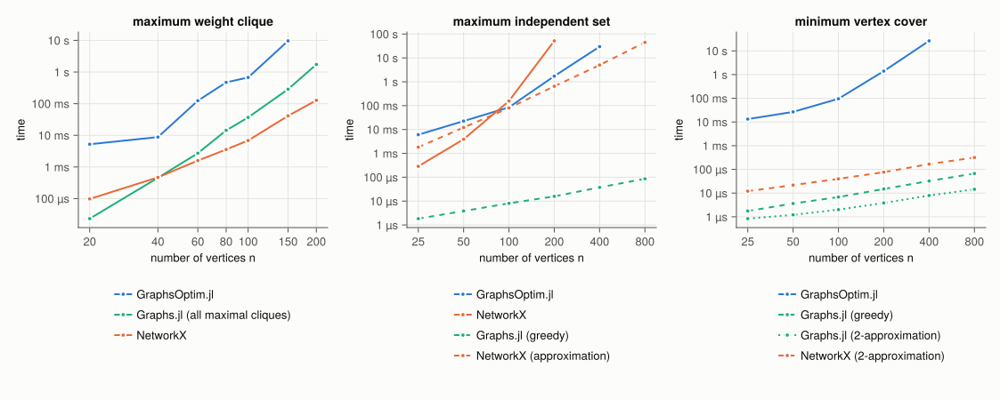
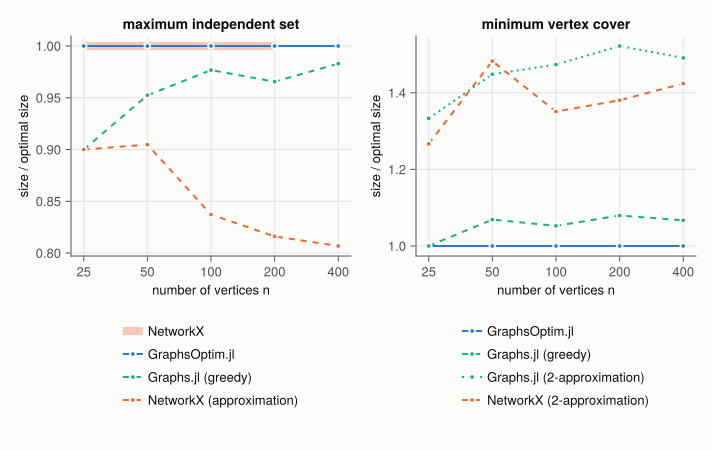

# Benchmarks

GraphsOptim.jl solves graph problems by formulating them as mathematical programs.
These benchmarks compare its algorithms with dedicated implementations from other Julia and Python libraries, in terms of running time and, when the reference is a heuristic, of solution quality.

## Where to find them

The benchmarks live in the [`benchmark/`](https://github.com/JuliaGraphs/GraphsOptim.jl/tree/main/benchmark) folder of the repository, which has its own Julia environment:

| File | Content |
| :--- | :--- |
| `benchmark/run.jl` | entry point, runs the suites and draws the figures |
| `benchmark/suites/*.jl` | one suite per family of problems: instances, methods and metrics |
| `benchmark/common.jl` | shared tools: timing, calls to Python, CSV files |
| `benchmark/plots.jl` | figures, saved in `docs/src/assets/benchmarks/` |
| `benchmark/results/*.csv` | raw results displayed on this page |

To run all suites, or only some of them, from the root of the repository:

```bash
julia --project=benchmark -e 'using Pkg; Pkg.instantiate()'
julia --project=benchmark benchmark/run.jl                    # all suites
julia --project=benchmark benchmark/run.jl cliques            # a single suite
julia --project=benchmark benchmark/run.jl --plots-only       # only redraw the figures
```

The Python libraries ([graspologic](https://graspologic-org.github.io/graspologic/), [NetworkX](https://networkx.org/) and [SciPy](https://scipy.org/)) are installed automatically by [CondaPkg.jl](https://github.com/JuliaPy/CondaPkg.jl) and called through [PythonCall.jl](https://github.com/JuliaPy/PythonCall.jl).

### Methodology

- All methods are run on the same random instances, with their default parameters.
- Running times are medians over repeated runs (at least one second or seven runs), measured after compilation. Python functions are timed on the Python side, so that the conversion of their inputs is not counted.
- All libraries use a single BLAS thread.
- The optimizer of GraphsOptim.jl is [HiGHS](https://highs.dev/), with a time limit of 60 seconds. A method that fails or takes more than 6 seconds on an instance is not run on the larger ones, hence the missing points in the figures.

The current results were obtained with:

```@eval
using GraphsOptim, Markdown
Markdown.parse(read(joinpath(pkgdir(GraphsOptim), "benchmark", "results", "environment.md"), String))
```

```@setup bench
using GraphsOptim, Markdown

function read_results(file)
    lines = readlines(joinpath(pkgdir(GraphsOptim), "benchmark", "results", file))
    header = Tuple(Symbol.(split(lines[1], ",")))
    parsevalue(x) = something(tryparse(Int, x), tryparse(Float64, x), String(x))
    return [NamedTuple{header}(Tuple(parsevalue.(split(line, ",")))) for line in lines[2:end]]
end

"""
Check that the methods in `rows` found the same value on each instance (grouped by `instance`).
"""
function agreement(rows; instance, what, who="all methods")
    mismatches = String[]
    for key in unique(instance.(rows))
        values = [r.value for r in rows if instance(r) == key && !(r.value isa Float64 && isnan(r.value))]
        if !all(v -> isapprox(v, first(values); rtol=1e-6), values)
            push!(mismatches, string(key))
        end
    end
    if isempty(mismatches)
        return Markdown.parse("On every instance, $who found the same $what.")
    else
        return Markdown.parse("!!! warning\n    The methods disagree on the $what for: $(join(mismatches, ", ")).")
    end
end
```

## Graph matching

[`graph_matching`](@ref) with `FAQ()` and `GOAT()`, against `graspologic.match.graph_match` (with `transport=True` for GOAT).
The instances are pairs of correlated Erdős–Rényi graphs with edge probability ``p = 0.1``: the second graph keeps each edge of the first one with a probability depending on the correlation ``\rho``, and its vertices are shuffled.

Running time for ``\rho = 0.9``:



Fraction of vertices matched to their ground-truth counterpart, for ``n = 150`` vertices (mean over 10 instances):



FAQ, initialized at the flat doubly stochastic matrix, only recovers the alignment of identical graphs; GOAT recovers it as soon as the correlation is high enough. Both libraries return alignments of the same quality.

## Graph edit distance

[`GraphsOptim.edit_distance`](@ref) with each of its integer programming formulations, against the exact algorithm `networkx.graph_edit_distance`, with uniform edit costs.
The instances are Erdős–Rényi graphs with edge probability ``0.4``, and copies of them where ``n / 3`` random vertex pairs have been flipped (an edge is added or removed).



```@example bench
agreement(read_results("edit_distance.csv"); instance=r -> r.n, what="edit distance")
```

## Shortest path, min-cost flow and assignment

- [`shortest_path`](@ref) against Dijkstra's algorithm from Graphs.jl (`dijkstra_shortest_paths`), on random directed graphs with average degree 5 and integer edge costs.
- [`min_cost_flow`](@ref) against the network simplex of NetworkX (`networkx.network_simplex`), on the same kind of graphs with integer capacities, where a tenth of the vertices are sources and another tenth are sinks.
- [`min_cost_assignment`](@ref), which solves a linear program with JuMP, and [`GraphsOptim.linear_sum_assignment`](@ref), against `scipy.optimize.linear_sum_assignment`, on uniformly random cost matrices.



```@example bench
agreement(read_results("paths_flows.csv"); instance=r -> (r.problem, r.n), what="optimal cost")
```

## Cliques, independent sets and vertex covers

- [`maximum_weight_clique`](@ref) against the exact algorithms `networkx.max_weight_clique` and the enumeration of all maximal cliques with Graphs.jl (`maximal_cliques`), on Erdős–Rényi graphs with edge probability ``0.5`` and integer vertex weights.
- [`maximum_weight_independent_set`](@ref) (with unit weights) and [`min_vertex_cover`](@ref) against exact and approximate algorithms from NetworkX and the heuristics of Graphs.jl, on Erdős–Rényi graphs with average degree 5.



```@example bench
cliques = read_results("cliques.csv")
agreement(
    filter(r -> r.exact == "true", cliques);
    instance=r -> (r.problem, r.n),
    what="optimal value",
    who="all exact methods",
)
```

```@example bench
invalid = [(r.problem, r.n, r.method) for r in cliques if r.valid != "true" && !(r.value isa Float64 && isnan(r.value))]
if isempty(invalid)
    Markdown.parse("All returned solutions are valid cliques, independent sets and vertex covers.")
else
    Markdown.parse("!!! warning\n    Invalid solutions: $(join(string.(invalid), ", ")).")
end
```

The integer programs of GraphsOptim.jl are exact, but the heuristics are much faster. Their solutions are compared to the optimum below (higher is better for independent sets, lower is better for vertex covers):


